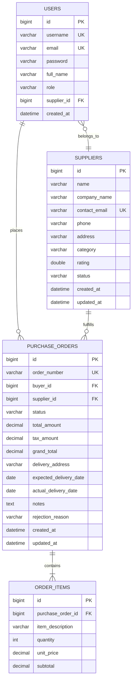
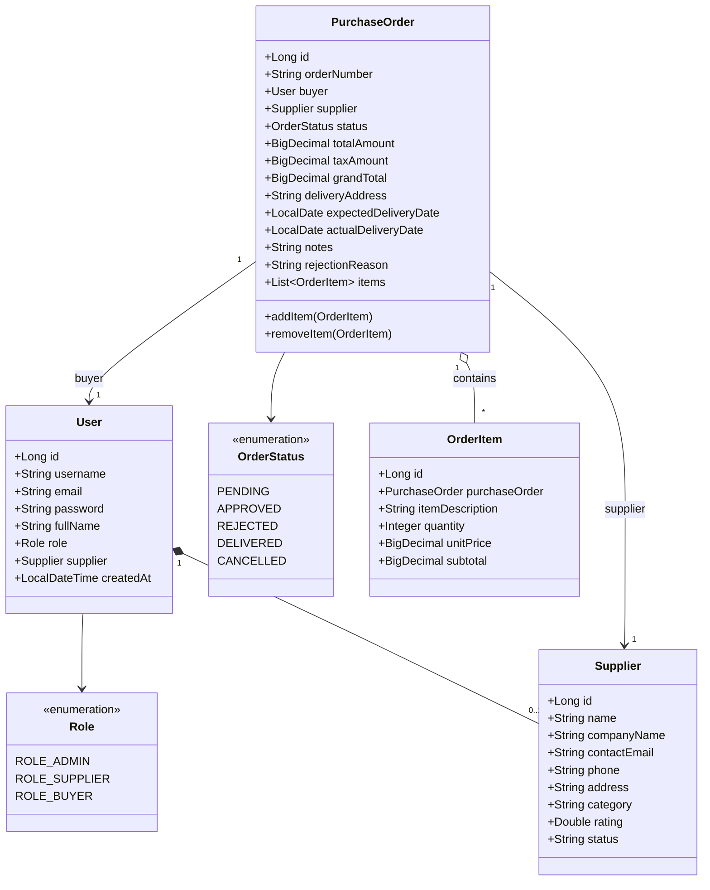
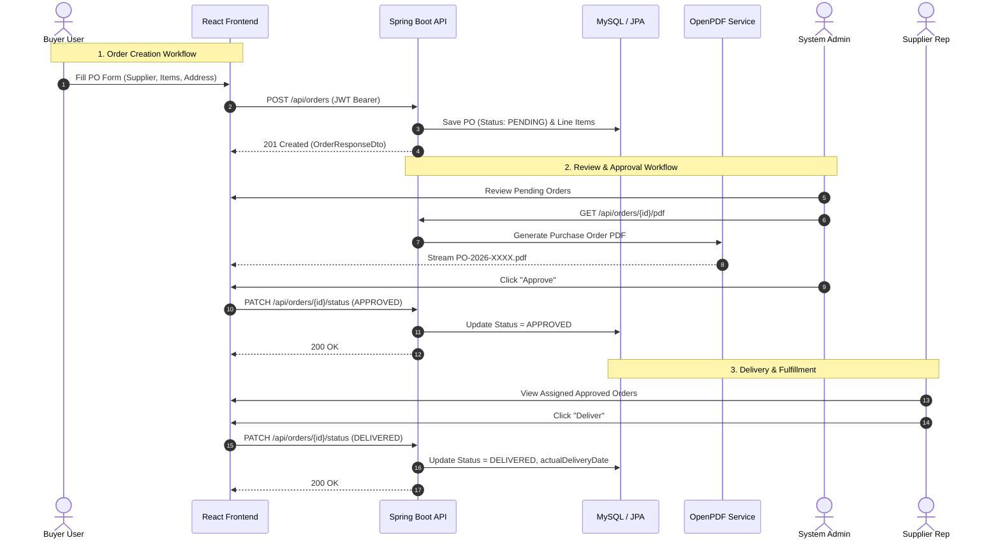
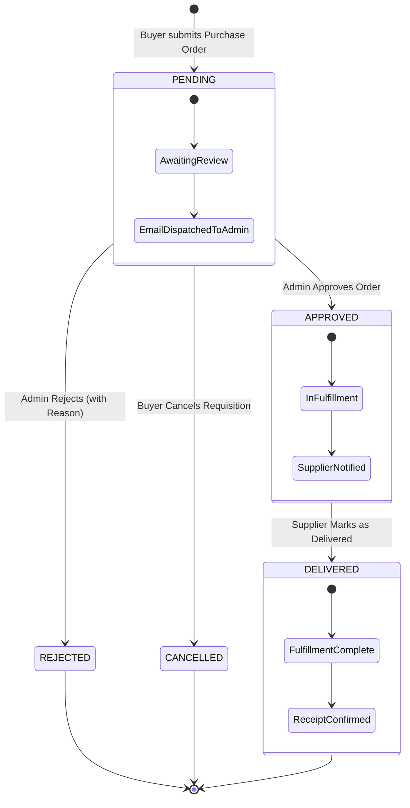

# 📦 ProcureFlow: Supplier & Purchase Order Management System

A production-grade Java Full Stack enterprise web application for managing supplier networks and procurement workflows. Built with **Spring Boot 3 (Java 17/25)**, **MySQL 8.0**, **React 18 + Vite**, and styled with **Tailwind CSS**.

---

## 🚀 Key Highlights & Features

- 🔐 **Role-Based Access Control (RBAC)**:
  - **Admin**: Full control to manage suppliers, approve/reject requisitions, manage system users, and inspect enterprise analytics.
  - **Buyer**: Create purchase orders with dynamic line items, auto-calculated taxes/totals, cancel pending orders, and track deliveries.
  - **Supplier**: View assigned orders for their company and update fulfillment status to *Delivered*.
- 🔄 **Order Lifecycle Workflow**:
  - `PENDING` $\longrightarrow$ `APPROVED` $\longrightarrow$ `DELIVERED` (with optional `REJECTED` by Admin or `CANCELLED` by Buyer).
- 📄 **Dynamic PDF Export**:
  - Generates corporate-grade Purchase Order PDF documents using **OpenPDF** with buyer details, vendor information, itemized pricing, tax summaries, notes, and authorized signature blocks (`GET /api/orders/{id}/pdf`).
- 📊 **Interactive Analytics Dashboard**:
  - Powered by **Chart.js** & **react-chartjs-2**: Order status breakdown (Doughnut), monthly procurement expenditure (Bar chart), and vendor volume metrics.
- 📚 **Swagger / OpenAPI Documentation**:
  - Interactive API playground with JWT Bearer authentication at `http://localhost:8080/swagger-ui.html`.
- 🧪 **Automated Testing & Postman Collection**:
  - JUnit 5 / Spring Boot test suite with 100% passing tests.
  - Pre-built Postman collection with automatic token capture in `/postman/Supplier_PO_Management.postman_collection.json`.

---

## 🛠️ Tech Stack

| Layer | Technologies |
|---|---|
| **Backend** | Java 17/25, Spring Boot 3.3.4, Spring Security 6, Spring Data JPA, Hibernate, OpenPDF, Springdoc OpenAPI 3 |
| **Database** | MySQL 8.0 (Primary) / H2 In-Memory (Zero-config profile for instant testing) |
| **Frontend** | React 18, Vite, Tailwind CSS, React Router DOM v6, Axios, Lucide React, Chart.js, react-chartjs-2 |
| **Security** | JWT (JSON Web Tokens via JJWT 0.12.5), BCrypt Password Hashing, Stateless Session |
| **Testing & Tools**| JUnit 5, Mockito, Postman Collection, Swagger UI, Maven 3.9 |

---

## 📐 Architecture & Diagrams

### 1. Entity-Relationship (ER) Diagram


### 2. UML Class Diagram


### 3. Order Workflow Sequence Diagram


### 4. Order State Machine


---

## 🔑 Pre-seeded Demo Accounts

When the application boots for the first time, `DataInitializer` automatically seeds realistic users, suppliers, and orders:

| Role | Email / Username | Password | Permissions & Features |
|---|---|---|---|
| **Admin** | `admin@example.com` / `admin` | `Password123` | Add/Edit/Delete Suppliers, Approve/Reject POs, User Management, Full Reports |
| **Buyer** | `buyer@example.com` / `buyer` | `Password123` | Create Purchase Orders, Track Status, Cancel Pending POs, Download PDFs |
| **Supplier** | `supplier@example.com` / `supplier` | `Password123` | View assigned orders for *Apex Industrial Supplies*, Mark orders as Delivered |

> 💡 *Tip*: On the frontend login screen, you can click the **1-Click Quick Login** buttons (Admin, Buyer, Supplier) to sign in instantly without typing!

---

## 💻 Local Setup & Execution Guide

### Prerequisites
- **Java**: JDK 17 or newer (OpenJDK 25 supported)
- **Node.js**: v18 or newer (v24 supported)
- **MySQL**: 8.0 (Optional if using the built-in H2 profile)

---

### Step 1: Database Setup (MySQL)

By default, the backend connects to MySQL on `localhost:3306` with database `supplier_po_db`.

Create the database in MySQL:
```sql
CREATE DATABASE IF NOT EXISTS supplier_po_db;
```

Configure your credentials in `backend/src/main/resources/application-mysql.properties` (or via environment variables `DB_USERNAME` and `DB_PASSWORD`):
```properties
spring.datasource.url=jdbc:mysql://localhost:3306/supplier_po_db?createDatabaseIfNotExist=true&useSSL=false&serverTimezone=UTC&allowPublicKeyRetrieval=true
spring.datasource.username=root
spring.datasource.password=your_password
```

*(Zero-Config Alternative)*: To run with the in-memory H2 database instead of MySQL, simply activate the H2 profile:
```bash
mvn spring-boot:run -Dspring-boot.run.profiles=h2
```

---

### Step 2: Start Backend

```bash
cd backend
mvn clean test
mvn spring-boot:run
```
*Or double click `run_backend.bat` in the root folder.*

Backend will start on: **`http://localhost:8080`**
- **Swagger OpenAPI Docs**: `http://localhost:8080/swagger-ui.html`
- **OpenAPI JSON Spec**: `http://localhost:8080/v3/api-docs`
- **H2 Console** (if active): `http://localhost:8080/h2-console`

---

### Step 3: Start Frontend

In a new terminal:
```bash
cd frontend
npm install
npm run dev
```
*Or double click `run_frontend.bat` in the root folder.*

Frontend will start on: **`http://localhost:5173`**

---

## 📡 REST API Endpoints Overview

| Method | Endpoint | Access | Description |
|---|---|---|---|
| `POST` | `/api/auth/login` | Public | Authenticates user & returns JWT token |
| `POST` | `/api/auth/register` | Public | Registers a new Buyer or Supplier account |
| `GET` | `/api/auth/me` | Authenticated | Gets current user profile |
| `GET` | `/api/suppliers` | Authenticated | Lists all suppliers (supports `?search=` filter) |
| `GET` | `/api/suppliers/{id}` | Authenticated | Gets supplier details by ID |
| `POST` | `/api/suppliers` | Admin | Adds a new supplier |
| `PUT` | `/api/suppliers/{id}` | Admin | Updates existing supplier profile |
| `DELETE` | `/api/suppliers/{id}` | Admin | Deletes a supplier |
| `POST` | `/api/orders` | Buyer / Admin | Places a new PO in `PENDING` status |
| `GET` | `/api/orders` | Authenticated | Role-filtered order list (`?status=` optional) |
| `GET` | `/api/orders/{id}` | Authenticated | Retrieves order details with item breakdown |
| `PATCH` | `/api/orders/{id}/status` | Authenticated | Transitions order status (Approve, Reject, Deliver, Cancel) |
| `GET` | `/api/orders/{id}/pdf` | Authenticated | Generates and streams official PO PDF |
| `GET` | `/api/reports/dashboard` | Authenticated | Aggregates stats & Chart.js datasets |
| `GET` | `/api/users` | Admin | Lists registered users |
| `DELETE` | `/api/users/{id}` | Admin | Deletes user |

---

## 🧪 Testing Guide

### 1. Automated JUnit Backend Tests
Run the automated test suite with:
```bash
cd backend
mvn test
```
All unit tests for order calculation, status validation, supplier duplication protection, and Spring context initialization execute with Mockito and JUnit 5.

### 2. Postman API Testing
1. Launch **Postman**.
2. Click **Import** $\rightarrow$ select `postman/Supplier_PO_Management.postman_collection.json`.
3. Run **Login as Admin**, **Login as Buyer**, or **Login as Supplier**.
4. The test script automatically saves the `token` collection variable and applies it to subsequent requests!

---

## 📂 Project Folder Structure

```
IP Project/
├── backend/
│   ├── src/main/java/com/management/supplierpo/
│   │   ├── config/              # SecurityConfig, OpenApiConfig, DataInitializer
│   │   ├── controller/          # REST Controllers
│   │   ├── dto/                 # Request & Response DTOs
│   │   ├── exception/           # Global Exception Handling
│   │   ├── model/               # JPA Entities (User, Supplier, PurchaseOrder, OrderItem)
│   │   ├── repository/          # Spring Data JPA Repositories
│   │   ├── security/            # JWT Token Provider, Filter, UserPrincipal
│   │   ├── service/             # Business Logic & OpenPDF Generation
│   │   └── SupplierPoApplication.java
│   ├── src/main/resources/      # application.properties (MySQL & H2 profiles)
│   ├── src/test/                # JUnit 5 & Mockito Tests
│   └── pom.xml
├── frontend/
│   ├── src/
│   │   ├── api/                 # Axios Client & API Endpoints
│   │   ├── components/          # Navbar, Sidebar, StatCard, StatusBadge
│   │   ├── context/             # AuthContext
│   │   ├── pages/               # Login, Register, Dashboard, Suppliers, Orders, CreateOrder, Reports, Users
│   │   ├── App.jsx
│   │   ├── main.jsx
│   │   └── index.css            # Tailwind Directives
│   ├── package.json
│   ├── tailwind.config.js
│   └── vite.config.js
├── docs/                        # Mermaid ER and UML diagrams
├── postman/                     # Ready-to-import Postman Collection
├── run_backend.bat              # 1-Click Windows Backend Launcher
├── run_frontend.bat             # 1-Click Windows Frontend Launcher
├── docker-compose.yml           # Optional Docker MySQL Setup
└── README.md
```